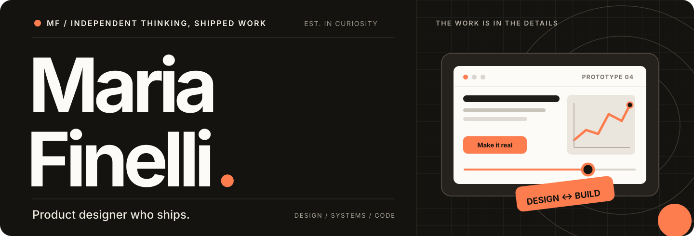
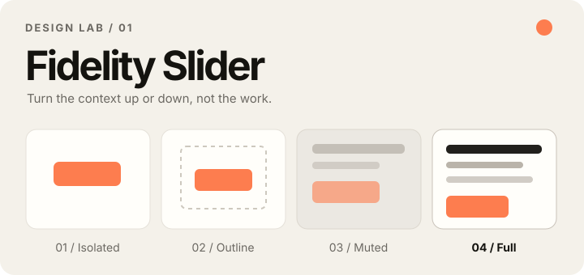
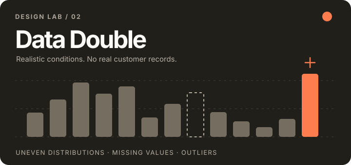
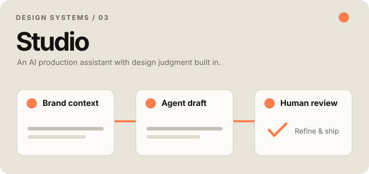
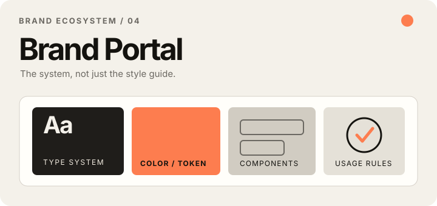

**Designing useful things. Building the ones I can't stop thinking about.**

[Portfolio](https://maria-sara.com) &nbsp; / &nbsp; [Design Lab](https://github.com/maria-finelli/design-lab) &nbsp; / &nbsp; [LinkedIn](https://www.linkedin.com/in/finellimaria) &nbsp; / &nbsp; [About me](https://maria-sara.com/about)

 

### Hi, I'm Maria.

I'm a Lead Product Designer at Runwise, previously at Datadog and Radar. I work across product and brand, and these days I build a lot of what I design with AI coding agents.

I majored in psychology at Rutgers and got mildly obsessed with memory and decision-making. That curiosity still shows up in the questions I ask and the details I care about.

The process can be messy. **I care a lot about getting the final thing right.**

### A few things I've been building

<table>
<tr>
<td width="50%" valign="top">

<h3>Fidelity Slider</h3>

Dial the visual context up or down—Isolated, Outline, Muted, or Full—without rebuilding a prototype.

<a href="https://github.com/maria-finelli/design-lab/tree/main/fidelity-slider">Explore the component ↗</a>
</td>
<td width="50%" valign="top">

<h3>Data Double</h3>

Synthetic datasets with realistic messiness—uneven distributions, missing values, and outliers—without real customer records.

<a href="https://github.com/maria-finelli/design-lab/tree/main/data-double">Explore the tool ↗</a>
</td>
</tr>
<tr>
<td width="50%" valign="top">

<h3>Runwise Studio</h3>

An AI production assistant I built with David, a senior engineer. My design context and skills guide its branded outputs, which I review and refine.

<a href="https://maria-sara.com/studio">Read the case study ↗</a>
</td>
<td width="50%" valign="top">

<h3>Runwise Brand Portal</h3>

A home for the brand system where people can find logos, colors, and imagery without having to ask. Stay idle for a surprise.

<a href="https://brand.runwise.com">Explore the portal ↗</a> · <a href="https://maria-sara.com/runwise-brand-portal">Case study ↗</a>
</td>
</tr>
</table>

### More things

**Runwise Growth Tools** — A building map, a water-data connection flow, and an event site. I designed and built all three with AI coding agents and added analytics to learn how people use them.

[Explore the tools and process →](https://maria-sara.com/runwise-growth-tools)

### Away from the screen

If I weren't doing this, I'd probably be a neuroscientist and part-time florist.

I love cooking because it's basically designing with flavors. And you have the added bonus of eating those designs.

I always want to hear about your pet. Please say hi for me.

---

Built with curiosity, considered details, and a lot of iteration.

[Portfolio](https://maria-sara.com) · [Design Lab](https://github.com/maria-finelli/design-lab) · [LinkedIn](https://www.linkedin.com/in/finellimaria)

